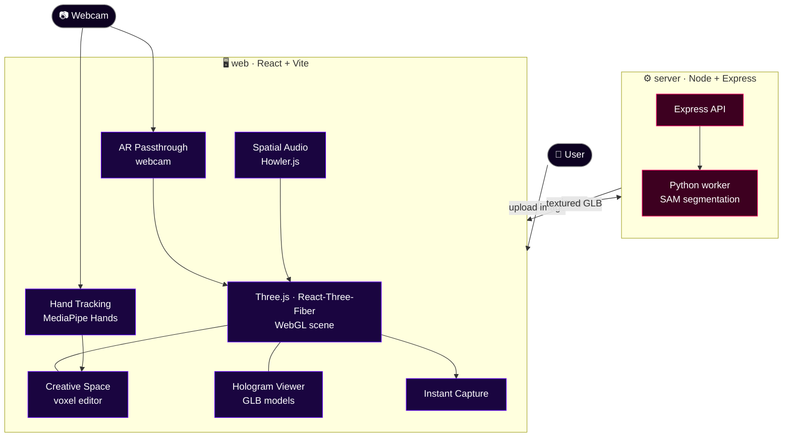
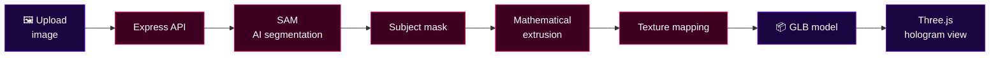
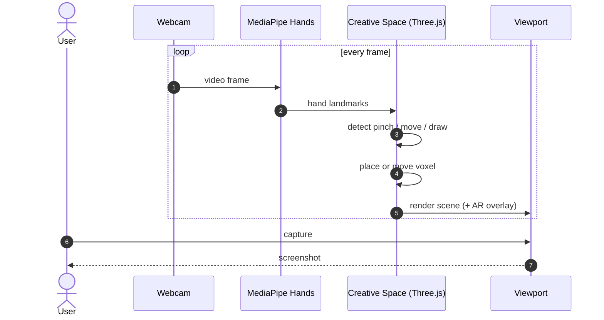

<div align="center">


# HOLO✦PAD

**Pull your images out of the screen and into space.**
A browser-native spatial interface where you build in 3D with nothing but your hands.

<br/>


[](https://holopad.vercel.app)
[](#-about)
[](https://gitdiagram.com/shiv0xparanoid/HOLOPAD)

[About](#-about) · [Features](#-features) · [Workflow](#-workflow) · [Tech Stack](#-tech-stack) · [Structure](#-project-structure) · [Run Locally](#-run-locally) · [Vision](#-vision)

</div>

<br/>

## ✦ About

HOLO✦PAD is an early-stage **spatial computing interface** exploring real-time graphics, mathematical models and human-computer interaction. It bridges the gap between flat 2D imagery and interactive 3D space.

Upload an image and it becomes a textured 3D hologram. Step into the **Creative Space** and build voxel by voxel, in mid-air, using hand gestures through your webcam.

<br/>

## ✦ Features

| | Feature | What it does |
|---|---|---|
| 🖼️ | **Image → Hologram** | Upload any image, and AI segmentation (SAM) plus mathematical extrusion produce a textured 3D model (GLB) |
| 🧱 | **Creative Space** | A fully functional voxel editor for building structures pixel by pixel in 3D |
| ✋ | **Hand Tracking** | Touchless pinch, draw and manipulate using MediaPipe Hands |
| 🌐 | **AR / Passthrough** | Overlay 3D content on the real world through the device webcam |
| 📸 | **Instant Capture** | Built-in screenshot tool to capture and share AR creations |
| 🔊 | **Spatial Audio** | Soundscapes powered by Howler.js |
| 🤖 | **MEG, AI Companion** | A holographic avatar with RAG memory, lip-sync, mood animations and mic input |

<br/>

## ✦ Workflow

> 🔍 **Interactive version:** open this repo on **[GitDiagram](https://gitdiagram.com/shiv0xparanoid/HOLOPAD)** for the auto-generated, clickable architecture view. (Replace `github.com` with `gitdiagram.com` in any repo URL.) The diagrams below are the curated versions.

### 1 · System architecture



### 2 · Image → Hologram pipeline



### 3 · Gesture → creation loop



<br/>

## ✦ Tech Stack

| Layer | Tools |
|---|---|
| **Frontend** | React · Vite · Three.js · React-Three-Fiber |
| **Computer Vision** | MediaPipe Hands (Google) |
| **Backend / AI** | Node.js · Express · Python (SAM integration) |
| **Audio** | Howler.js |
| **Hosting** | Vercel |

<br/>

## ✦ Project Structure

```
HOLOPAD/
├── web/               # React + Vite frontend · 3D scene, voxel editor, hand tracking
├── server/            # Node + Express API · image to hologram pipeline
├── PITCH_GUIDE.md     # pitch notes
├── Holopad.pdf        # project deck
├── logo.png
└── package.json
```

<br/>

## ✦ Run Locally

> **Needs:** Node 18+, Python 3 (for the SAM pipeline), a webcam for hand tracking.

```bash
git clone https://github.com/shiv0xparanoid/HOLOPAD.git
cd HOLOPAD

# frontend
cd web
npm install
npm run dev

# backend (new terminal)
cd server
npm install
npm start
```

Or skip setup and try it live at **[holopad.vercel.app](https://holopad.vercel.app)**.

> 💡 Hand tracking and AR mode need camera permission. Use Chrome or Edge on a device with a decent webcam for the best results.

<br/>

## ✦ Vision

The goal is to move interaction away from flat screens and into physical space, where **depth, motion and intent** are captured directly.

<br/>

<div align="center">

Built by **[Shivang](https://github.com/shiv0xparanoid)**, Founder of HOLO✦PAD

<sub>If this made you want to reach into your screen, drop a ⭐</sub>


</div>
